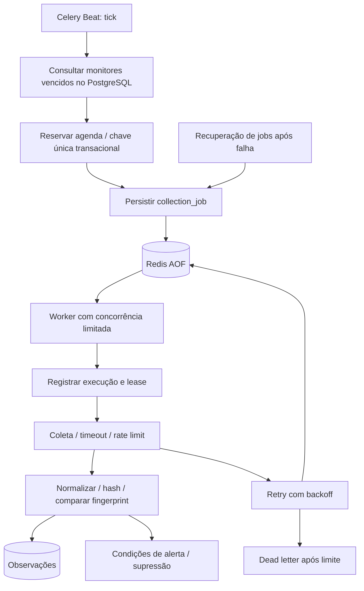

# Monitoramento contínuo

Monitores guardam investigação, conector, consulta, configuração, prioridade e agenda.
Intervalos e cron são executados em UTC. Pausar um monitor impede novas execuções; trabalhos
já em andamento dependem de cancelamento cooperativo.

## Fluxo de execução



Execute exatamente **um Beat por stack**. A fila usa Redis persistente, mas jobs e execuções
ficam no PostgreSQL como fonte de verdade. A recuperação trata tarefas persistidas não
publicadas ou leases vencidas sem duplicar efeitos. `acks_late` sozinho não garante
idempotência — unicidade por `fingerprint` e transações limitam reprocessamento.

## Alertas e notificações

Alertas podem ser entregues por três canais:

| Canal | Configuração |
|---|---|
| Interno (banco) | Sempre ativo; listado em `GET /api/v1/alerts` |
| SMTP | `SMTP_HOST`, `SMTP_PORT`, `SMTP_USERNAME`, `SMTP_PASSWORD`, `SMTP_FROM` |
| Webhook HMAC | `ALERT_WEBHOOK_URL` (HTTPS + DNS pin) + `ALERT_WEBHOOK_SECRET` |

Entrega manual autenticada: `POST /api/v1/alerts/{id}/deliver?recipient=email@example.com`.
O parâmetro `recipient` é validado como `EmailStr` e não pode conter `\n`/`\r`.

O webhook assina o payload com `hmac.HMAC(key, body, sha256)` no header
`X-OSINT-Signature: sha256=<hex>`. O destino é validado estaticamente por
`validate_public_url()` e a conexão usa `PublicNetworkBackend` para prevenir DNS rebinding.

## Expurgo de evidências

```bash
make purge
```

Remove evidências com `retention_until` vencido. Faça backup antes de uma política
agressiva de expurgo. O script `scripts/purge_expired_evidence.py` usa SQLAlchemy 2.x
`select()`, reporta contagem de erros e retorna código de saída 1 em caso de falhas de storage.

## Diagnóstico operacional

```bash
docker compose logs --tail=100 beat worker
docker compose exec worker celery -A app.celery_app:celery_app inspect ping
docker compose restart worker beat
```

## Comportamento esperado

- **Primeira coleta**: sempre gera nova observação.
- **Revisita idêntica**: não produz alerta duplicado (mesmo fingerprint).
- **Alteração detectada**: mantém as duas observações (anterior e atual) e gera alerta.
- **Erros persistentes**: exigem alerta operacional; nenhum dado de fonte é simulado.

## Configuração

| Variável | Padrão | Descrição |
|---|---|---|
| `WORKER_CONCURRENCY` | `4` | Processos worker; deve ser compatível com quotas remotas |
| `SCHEDULER_TICK_SECONDS` | `15` | Frequência de varredura do Beat |
| `CONNECTOR_TIMEOUT_SECONDS` | `20` | Timeout HTTP por requisição de conector |
| `COLLECTION_MAX_RECORDS` | `100` | Limite de observações por execução |
| `COLLECTION_MAX_ATTEMPTS` | `3` | Tentativas antes de `dead_letter` |

Redis `noeviction` permite backpressure explícito quando a memória acaba. Reinícios de Beat
recalculam monitores a partir do banco; o arquivo de schedule fica em `/tmp`.

Relatórios e documentação não devem assumir escalabilidade validada sem benchmark real.
Veja [docs/IMPLEMENTATION_MATRIX.md](docs/IMPLEMENTATION_MATRIX.md) para quais cenários
foram efetivamente testados.
